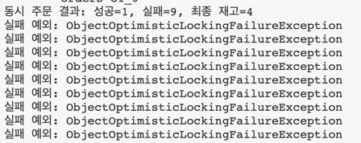

4주차 주제 : 영속성 컨텍스트와 트랜잭션, 동시성 제어
사실 여름방학에 sqld 자격증을 따며 트랜잭션, 동시성의 개념에 대해서는 인지하고 있었다. 그래서인지 이번주는 따라가기 조금 수월했던 것 같다.
고객이 주문을 생성하면 재고 확인, 재고 차감, 주문 저장이 동시에 이루어져야한다.
이것이 atomic(원자적)하지 않게 이루어지면, 두 주문이 동시에 들어와도 하나의 주문에 해당하는 재고만 차감될 수 있다.

영속성 컨텍스트란 JPA가 조회한 엔티티를 트랜잭션동안 관리하는 공간이다.
관리중인 엔티티에 변경이 발생하면 JPA가 이를 감지하고 update sql이 실행되기에 따로 .save 메서드를 작성하지 않아도 update가 이루어진다.
이때 변경이 발생했는지를 인식하기 위해 사용하는 것이 스냅샷(엔티티를 처음 조회했을 때의 상태를 저장해둔 복사본)이다.

여러 트랜잭션이 같은 데이터를 수정할 때 충돌을 제어해 데이터의 일관성을 지키는 방법으로 두가지 DB 락이 존재한다.
낙관적 락은 기본적으로 충돌이 자주 일어나지 않을 것이라고 가정하는 방식이다. 저장해야하는 시점에 version 변수로 충돌을 확인한다.
엔티티 변경 시마다 version이 증가하기 때문에, 자신이 update를 시도하는 순간에 version이 그대로일 때만 update성공하는 방식이다.
**궁금한 점 : version 사용 시 오버헤드 그렇게 크지 않은가?**
-> DB 및 네트워크 수준에서의 오버헤드는 거의 없음, 테이블에 BIGINT 컬럼 하나 추가되는 수준(8 Byte)이므로 무시할 수 있는 수준

비관적 락은 기본적으로 충돌이 일어날 것이라고 가정하는 방식이다. select ~ for update 문을 사용하여 구현된다.
잠금으로 정합성을 지키는 대신 대기 비용(요청이 몰리면 대기시간 증가하고 전체 처리량이 감소)을 지불하는 개념이다.
**궁금한 점 : OS에서 배운 spin lock과 semaphore중 어디에 더 가까운 개념인가?**
-> 비관적 락(SELECT ... FOR UPDATE)은 락을 선점한 트랜잭션이 끝날 때까지 다른 트랜잭션을 대기 큐에 넣어 블로킹시키는 방식으로 동작
   Semaphore/Mutex의 Block-Wakeup 메커니즘과 완전히 동일

각각의 장단점이 확실한만큼 서비스의 환경에 따라 적절한 방식을 사용하는 것이 중요하다고 생각이 든다.